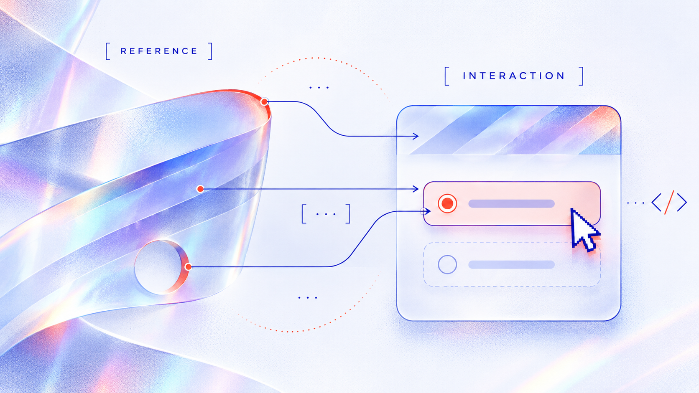

# Reference to Demo

English · [简体中文](README.zh-CN.md)

**Turn visual references into working interactions and usable developer handoffs.**



## What you receive

A runnable demo, traceable design decisions, tokens, state behavior, and integration boundaries.

[Read the skill](skills/reference-to-demo/SKILL.md) · [中文指令](skills/reference-to-demo/SKILL.zh-CN.md)

## Try the example

Prism Pass offers two finishes, reversible local selection, keyboard interaction, and a documented integration event.

[Example notes](skills/reference-to-demo/examples/prism-pass/brief.md) · [Interactive example](skills/reference-to-demo/examples/prism-pass/index.html) · [中文示例](skills/reference-to-demo/examples/prism-pass/index.zh-CN.html)

Download the repository and open the example HTML in a browser. GitHub displays HTML source rather than running the example. Examples work offline and use synthetic material.

## Install

Give this URL to your GitHub-capable skill installer and install the complete skill folder:

```text
https://github.com/Cynthiawongss/reference-to-demo/tree/main/skills/reference-to-demo
```

Keep `references/`, `examples/`, and any `scripts/` and `agents/` subfolders together. `SKILL.md` is the default English entry; `SKILL.zh-CN.md` is its Chinese equivalent. The workflow follows the requested output language.

Alternatively, download an English or Chinese skill ZIP from the [v0.1.0 release](https://github.com/Cynthiawongss/reference-to-demo/releases/tag/v0.1.0). Install one language variant.

## Example request

```text
Use $reference-to-demo to adapt this card reference to my existing product. Build a selectable component and include its state behavior and developer handoff.
```

## Verify

From the repository root:

```sh
npm install
npx playwright install chromium
node tools/check_browser.cjs
```

See [validation scope and limits](validation/README.md) for browser checks. Python checkers require only Python 3.10+ and its standard library.

## Scope

Local selection is not a saved server response. The workflow does not expand a small reference task into a full redesign.
